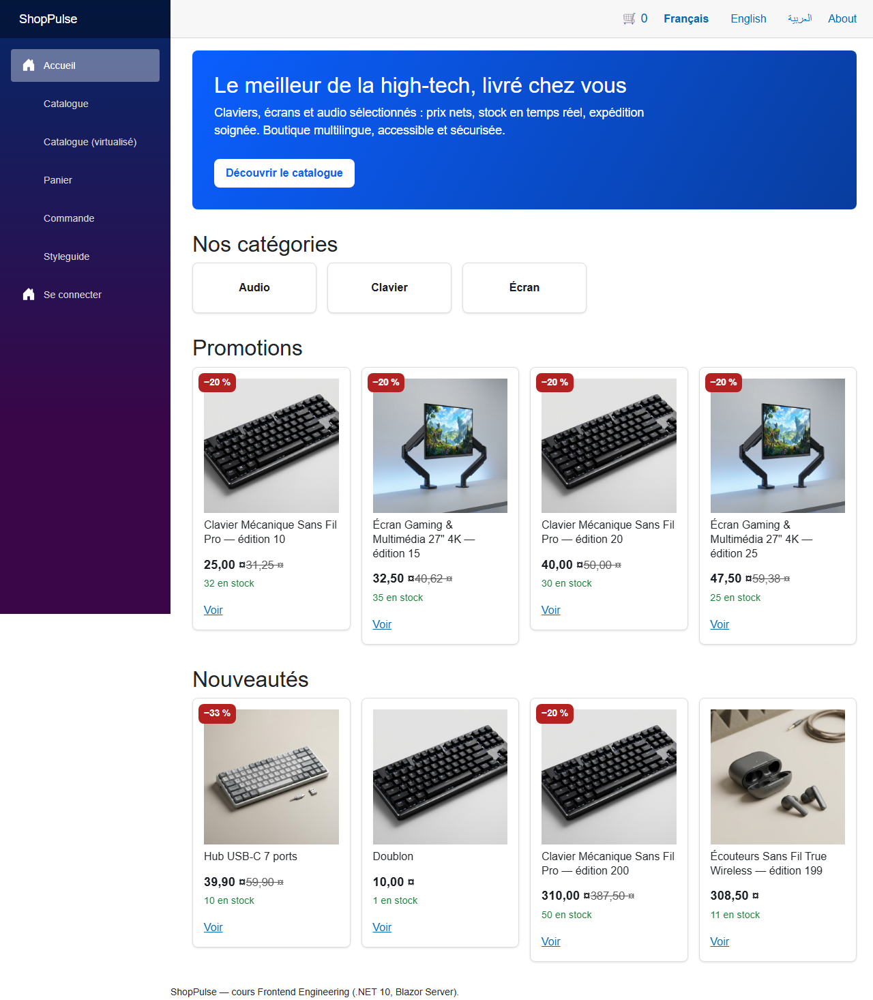
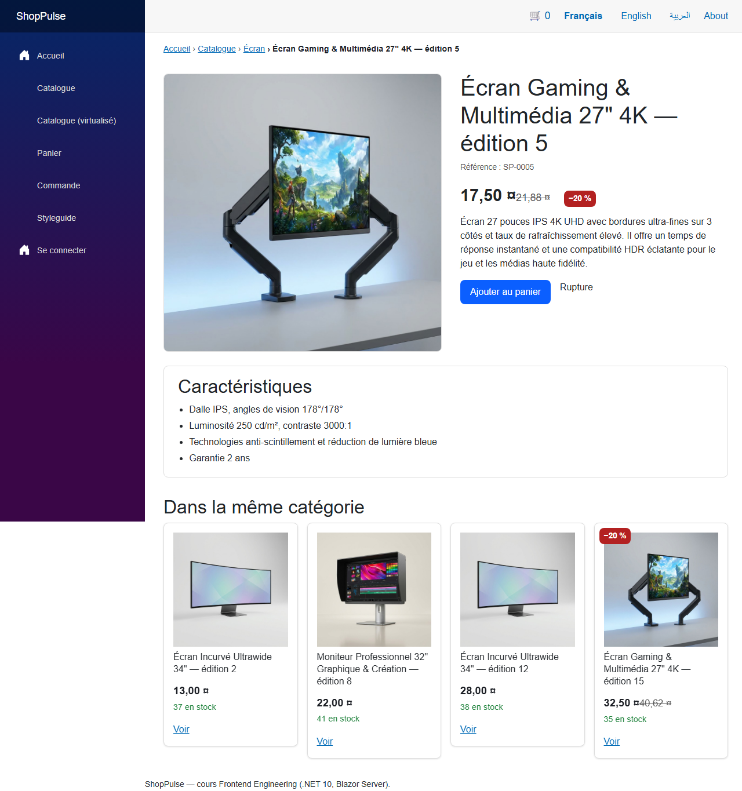
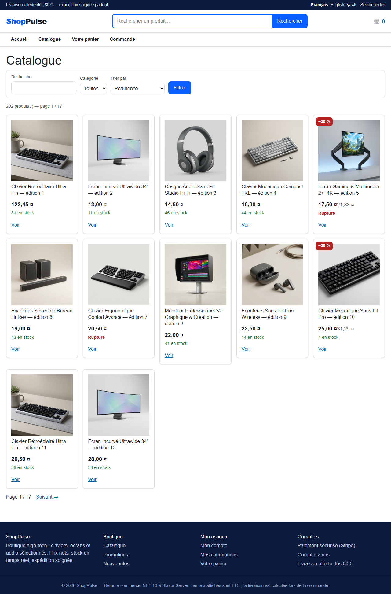
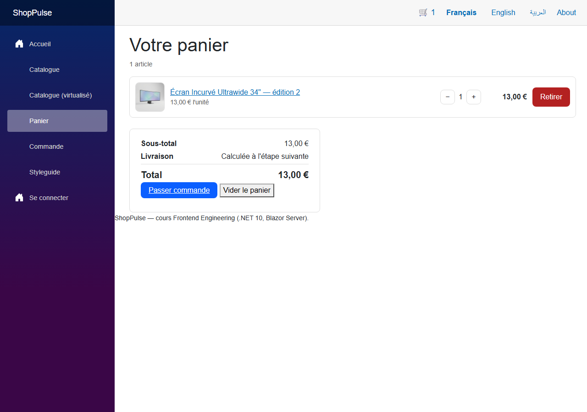

# ShopPulse — Boutique e-commerce complète avec .NET 10 & Blazor Server

[](https://dotnet.microsoft.com/)
[](https://dotnet.microsoft.com/apps/aspnet/web-apps/blazor)
[](#tests)
[](LICENSE)

> **EN — Summary.** ShopPulse is a full-featured e-commerce store built with **.NET 10,
> Blazor Server and PostgreSQL**: real-time catalog, idempotent order pipeline,
> Keycloak accounts, back-office with an order-status state machine, Stripe payments
> (signed webhook as the only source of truth), WCAG 2.2 AA accessibility and
> fr/en/ar internationalization. Built as a modular monolith (Razor Class Libraries,
> ports & adapters) with 23 automated tests (NetArchTest, Playwright E2E, axe-core).
> Full technical documentation in French below and in [`docs/`](docs/).

---

## Présentation

ShopPulse est une **vraie boutique en ligne** construite de bout en bout : catalogue
recherchable, panier, tunnel de commande avec paiement, comptes clients, back-office
d'administration — le tout en **monolithe modulaire** où chaque frontière est imposée
par le compilateur et vérifiée par des tests d'architecture.

Le projet est né d'un cours complet de *Frontend Engineering* (8 modules, 160 concepts)
dont il était le fil rouge, puis a été transformé en produit réel en 6 phases :
base de données, catalogue, commandes, comptes clients, back-office, paiement Stripe —
plus une refonte design e-commerce complète. Chaque étape est documentée dans
[`docs/`](docs/) avec les pièges réels rencontrés et corrigés.

## Captures d'écran

| Accueil vitrine | Fiche produit |
|---|---|
|  |  |

| Catalogue | Panier |
|---|---|
|  |  |

## Fonctionnalités

**Boutique**
- Catalogue PostgreSQL : recherche insensible à la casse, filtres par catégorie,
  pagination — tout en SQL côté serveur
- Fiches produit e-commerce : fil d'Ariane, prix promo (badge %, prix barré),
  caractéristiques techniques, produits liés, JSON-LD (SEO)
- Panier persistant, stock **temps réel** (SignalR) et **transactionnel** :
  jamais négatif, même sous achats simultanés (UPDATE conditionnel atomique)
- Commandes **idempotentes** (clé par tentative + unicité en base) : un retry réseau
  ou un double-clic ne crée jamais de doublon ; prix **toujours recalculés serveur**
- Paiement **Stripe** (Payment Element) : le webhook signé est la seule preuve de
  paiement ; simulateur intégré pour développer sans compte Stripe
- Emails transactionnels (confirmation, statuts) — capturés par Mailpit en dev

**Comptes & administration**
- OIDC/PKCE avec Keycloak : cookie `__Host-` chiffré, jetons côté serveur,
  contrôle d'accès anti-énumération (404 plutôt que 403)
- « Mon compte » : profil, historique et détail des commandes
- Back-office réservé au rôle `stock-manager` : machine à états des commandes
  (Pending → Paid → Shipped / Cancelled), CRUD produits complet

**Qualité**
- Accessibilité **WCAG 2.2 AA** vérifiée par axe-core (5 pages, 3 langues, 0 violation)
- Internationalisation **fr / en / ar** (RTL, pluriels CLDR, formats par culture)
- Rendu statique par défaut, îlots interactifs `InteractiveServer` ciblés

## Architecture

```
ShopPulse.slnx
src/
  ShopPulse.Domain/          # Modèles purs — aucune référence framework (imposé par tests)
  ShopPulse.Application/     # Ports : IProductService, IOrderPlacer, IPaymentGateway…
  ShopPulse.Infrastructure/  # Adaptateurs : EF Core, clients HTTP, Stripe, SMTP
  ShopPulse.Contracts/       # DTO partagés API ↔ clients
  ShopPulse.SharedKernel/    # Types transverses (Store<T>, ICartGateway)
  ShopPulse.Modularity/      # IShopModule + ModuleCatalog (composition)
  ShopPulse.UI/              # Design system : jetons --sp-*, composants Atomic Design
  ShopPulse.Features.Catalog/Cart/Checkout/Account/Admin/   # Features en RCL
  ShopPulse.Api/             # Minimal API : produits, commandes, paiement, admin, SignalR
  ShopPulse.Web/             # Hôte Blazor Server : assemble les modules
tests/
  ShopPulse.Architecture.Tests/  # NetArchTest : frontières de dépendances
  ShopPulse.E2E/                 # Playwright : parcours invité, compte, admin
  ShopPulse.A11y/                # axe-core : WCAG 2.2 AA sur 5 pages × 3 langues
```

Principes appliqués partout : **une seule source de vérité par donnée**, tout cache a
une règle d'invalidation, tout ce qui vient du navigateur est non fiable, les écritures
réseau sont idempotentes, les frontières sont vérifiées par des tests.

## Stack technique

| Couche | Technologies |
|---|---|
| Frontend | .NET 10, Blazor Server (Static SSR + InteractiveServer), CSS custom properties |
| API | ASP.NET Core Minimal API, SignalR, JWT Bearer, Rate Limiting, Problem Details |
| Données | PostgreSQL 17, Entity Framework Core 10 (migrations, jsonb, identity) |
| Identité | Keycloak (OIDC + PKCE), cookie `__Host-` chiffré |
| Paiement | Stripe.net (Payment Intents, webhooks signés) + simulateur dev |
| Emails | MailKit + Mailpit (capture dev) |
| Tests | xUnit, NetArchTest.Rules, Playwright, axe-core (Deque.AxeCore) |
| Infra | Docker Compose (5 services), Dockerfiles multi-étapes |

## Démarrage rapide

Prérequis : SDK **.NET 10**, Docker Desktop, navigateur Chromium (tests E2E).

```bash
# 1. Infrastructure (PostgreSQL + Keycloak + Mailpit)
docker compose up -d db mailpit keycloak

# 2. API (applique les migrations et le seed au démarrage)
cd src/ShopPulse.Api && dotnet run          # → http://localhost:5299

# 3. Web (dans un autre terminal)
cd src/ShopPulse.Web && dotnet run          # → http://localhost:5026
```

| Accès | URL / identifiants |
|---|---|
| Boutique | http://localhost:5026 (redirige vers `/fr/`) |
| Emails capturés (Mailpit) | http://localhost:8025 |
| Keycloak | http://localhost:8080 — `demo`/`demo1234` (stock-manager), `client`/`client1234` |
| Paiement | Sans clés Stripe : bouton « Simuler le paiement (démo) ». Avec clés de test : `dotnet user-secrets set "Stripe:SecretKey" sk_test_...` (voir [`docs/17`](docs/17-boutique-reelle-06-paiement-stripe.md)) |

Toute la pile en conteneurs : `docker compose up -d --build` (ports 5026/5299/8080).

## Tests

```bash
dotnet test tests/ShopPulse.Architecture.Tests   # 14 règles de dépendances
dotnet test tests/ShopPulse.E2E                  # 4 parcours Playwright (serveurs requis)
dotnet test tests/ShopPulse.A11y                 # 5 pages × axe-core WCAG 2.2 AA
```

## Documentation

Chaque étape est documentée en français, avec les décisions, les **pièges réels**
rencontrés (cookie `__Host-` vs PathBase, `MapInboundClaims`, séquence identity
désynchronisée…) et les limites assumées :

- [`docs/04-architecture.md`](docs/04-architecture.md) — le monolithe modulaire
- [`docs/07-security.md`](docs/07-security.md) — le modèle de sécurité
- [`docs/08-accessibilite-i18n.md`](docs/08-accessibilite-i18n.md) — WCAG 2.2 AA & fr/en/ar
- [`docs/11`](docs/11-boutique-reelle-01-base-de-donnees.md) à
  [`docs/17`](docs/17-boutique-reelle-06-paiement-stripe.md) — la transformation en
  vraie boutique, phase par phase

## Limites connues & feuille de route

Honnêteté technique — ce qui reste à faire est listé dans le code (`Limite.` en
commentaires) et notamment : chemin Stripe réel à valider avec de vraies clés de test,
refresh token OIDC, pattern Outbox pour les emails, TVA/frais de port multi-pays,
remboursements, i18n des pages compte/back-office, observabilité (health checks,
logs structurés).

## Auteur

**Issiaga Soumah** — [@IssiagaGame224](https://github.com/IssiagaGame224)

## Licence

[MIT](LICENSE) — le code est librement réutilisable ; la documentation du dossier
`docs/` peut être citée avec attribution.
